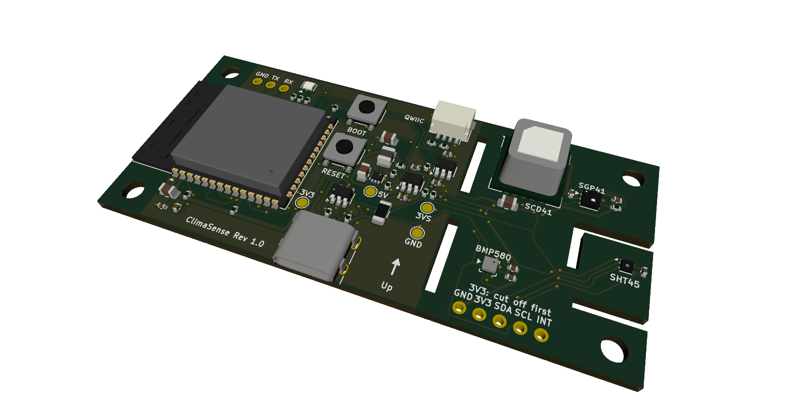

# ClimaSense

An ESP32-based indoor environment sensor. It periodically measures temperature, humidity, CO2, VOC/NOx and air pressure and publishes the readings via MQTT. Wi-Fi is configured through a captive portal.

## The board

75 × 34 mm, two layers, powered and programmed through USB-C. It hangs on a wall with the USB cable down; the arrow on the silkscreen points up. From left to right:

- **ESP32-C6 module** with its antenna at the left edge, the status LED above it.
- **Buttons, power and USB**: BOOT and RESET, the 3.3 V converter, the USB-C socket on the bottom edge and a Qwiic connector on the top edge.
- **A milled slot**, which keeps the heat of everything on the left away from the sensors.
- **The sensors**: SCD41 (CO2) and SGP41 (VOC/NOx) at the top, because they are the two that warm up and heat rises; the SHT45 (temperature and humidity) below them at the right edge, on a tongue of its own that is cut free on three sides, with nothing underneath it; and the BMP580 (pressure) at the lower left, which gives off practically no heat.

The pictures are renders of the KiCad design (`python hardware/rev-1.0/tools/gen_images.py`), not photographs: no board has been manufactured yet. How the board is laid out and why: [`docs/hardware/layout.md`](docs/hardware/layout.md).

## Contents

| Folder | What |
| --- | --- |
| [`hardware/`](hardware/) | KiCad project for the PCB (designed for full fab assembly) |
| [`firmware/`](firmware/) | ESP32 firmware |
| [`docs/`](docs/) | Research and design decisions |

## Status

- **Hardware, revision 1.0:** schematic and board are finished and pass KiCad's rule checks; the order files for JLCPCB are in [`hardware/rev-1.0/fab/`](hardware/rev-1.0/fab/). Not manufactured yet, and not reviewed by a second person.
- **Firmware:** in progress, and so far only built, not run on hardware. See [`firmware/README.md`](firmware/README.md) and [`docs/firmware/architecture.md`](docs/firmware/architecture.md).

What was decided and why: [`docs/decisions.md`](docs/decisions.md). The component research behind it: [`docs/research/hardware-options.md`](docs/research/hardware-options.md).

## Licence

MIT, for the firmware, the KiCad design and the docs: see [`LICENSE`](LICENSE). Third-party code keeps its own licence, next to it in its `vendor/` folder (so far Sensirion's Gas Index Algorithm, BSD-3-Clause).
