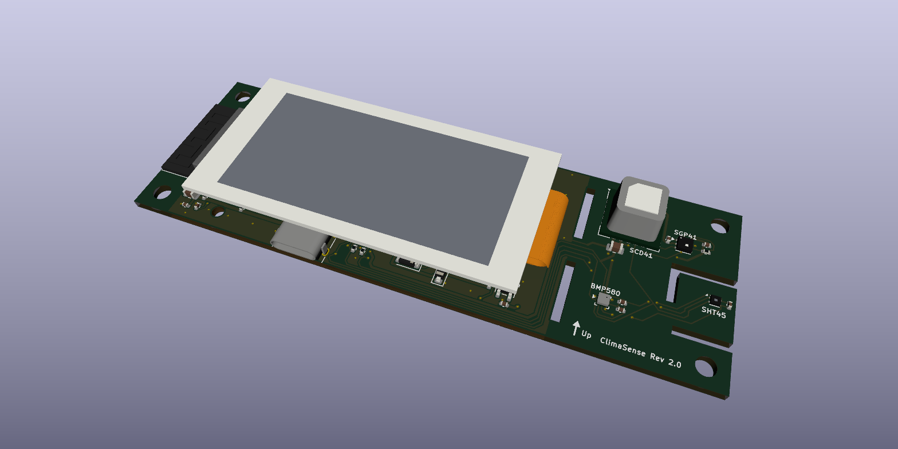
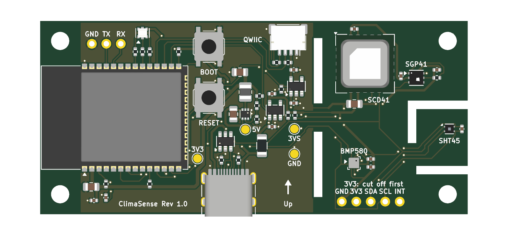
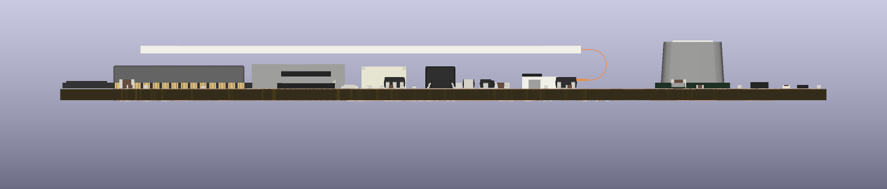
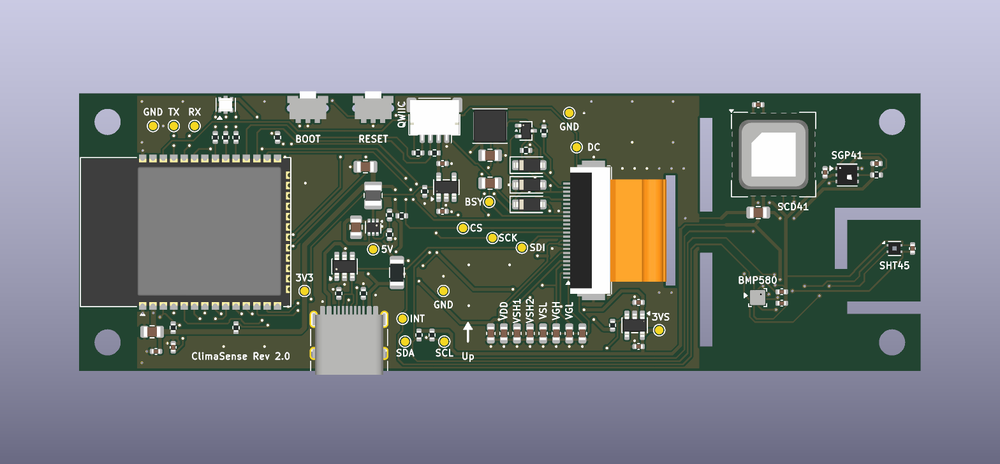
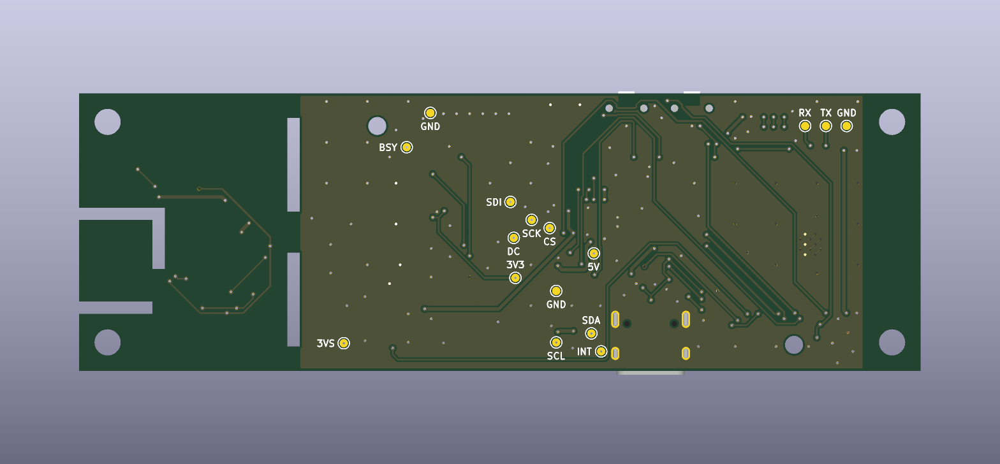
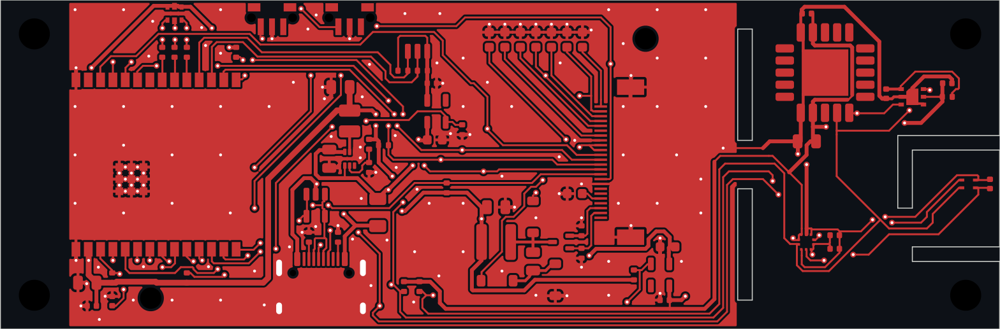
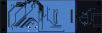

# ClimaSense

An ESP32-based indoor environment sensor. It periodically measures temperature, humidity, CO2, VOC/NOx and air pressure and publishes the readings via MQTT. Wi-Fi is configured through a captive portal.

The picture shows the latest revision, 2.0, which is still in design. All pictures here are renders and plots of the KiCad design (`python hardware/rev-<N>/tools/gen_images.py`), not photographs.

## Revision 1.0

The first board, ordered at JLCPCB on 2026-11-20.

75 × 34 mm, two layers, powered and programmed through USB-C. It hangs on a wall with the USB cable down; the arrow on the silkscreen points up. From left to right:

- **ESP32-C6 module** with its antenna at the left edge, the status LED above it.
- **Buttons, power and USB**: BOOT and RESET, the 3.3 V converter, the USB-C socket on the bottom edge and a Qwiic connector on the top edge.
- **A milled slot**, which keeps the heat of everything on the left away from the sensors.
- **The sensors**: SCD41 (CO2) and SGP41 (VOC/NOx) at the top, because they are the two that warm up and heat rises; the SHT45 (temperature and humidity) below them at the right edge, on a tongue of its own that is cut free on three sides, with nothing underneath it; and the BMP580 (pressure) at the lower left, which gives off practically no heat.

How the board is laid out and why: [`docs/hardware/layout.md`](docs/hardware/layout.md).

## Revision 2.0 (in design)

Revision 2.0 adds a 2.13" black-and-white e-paper panel and is 103 × 34 mm. **It is still being designed and has not been built or ordered.** Its notes: [`docs/hardware/rev-2.0.md`](docs/hardware/rev-2.0.md).

The parts face the room, as on revision 1.0. The panel lies above them, on a printed frame 4.75 mm above the board that is not designed yet; its flexible tail folds back under it into a connector. The picture at the top of this page shows the panel in place; the pictures below show the board without it.

From the side, with the USB connector towards the viewer: the panel above the parts, its tail folding back under it on the right, and the SCD41, the tallest part, beside it:

The panel covers everything from the module to the display connector. The buttons and the status LED are on the top edge, and the sensors keep their arrangement behind the slot:

The back carries no parts, only the test pads:

The copper of the two layers. Most tracks run on the component side; the back is mostly ground. Both are drawn as seen from the component side, the bottom layer through the board, so the two pictures line up:

## Contents

| Folder | What |
| --- | --- |
| [`hardware/`](hardware/) | KiCad project for the PCB (designed for full fab assembly) |
| [`firmware/`](firmware/) | ESP32 firmware |
| [`docs/`](docs/) | Research and design decisions |

## Status

- **Hardware, revision 1.0:** schematic and board are finished and pass KiCad's rule checks; the order files for JLCPCB are in [`hardware/rev-1.0/fab/`](hardware/rev-1.0/fab/). Not manufactured yet, and not reviewed by a second person.
- **Hardware, revision 2.0:** in design (e-paper display above the parts, on a frame); the board routes completely and passes KiCad's rule checks, but it is not finished and not ordered.
- **Firmware:** in progress, and so far only built, not run on hardware. See [`firmware/README.md`](firmware/README.md) and [`docs/firmware/architecture.md`](docs/firmware/architecture.md).

What was decided and why: [`docs/decisions.md`](docs/decisions.md). The component research behind it: [`docs/research/hardware-options.md`](docs/research/hardware-options.md).

## Licence

MIT, for the firmware, the KiCad design and the docs: see [`LICENSE`](LICENSE). Third-party code keeps its own licence, next to it in its `vendor/` folder (so far Sensirion's Gas Index Algorithm, BSD-3-Clause).
