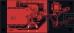
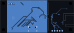

# PCB layout — revision 1.0

Status: **placed and fully routed by script; not yet reviewed by a person.** A measurement of the routing found four weaknesses, which have been fixed (see [Review of the routing](#review-of-the-routing-2026-11-19)). KiCad's design rule check reports no violations, no difference between board and schematic, and no open connections. That shows the board is consistent with the schematic and with the manufacturing rules below; it does not replace a look by someone who has laid out boards before.

File: [`hardware/climasense.kicad_pcb`](../../hardware/climasense.kicad_pcb), created by [`hardware/tools/gen_pcb.py`](../../hardware/tools/gen_pcb.py).

## Board

| | |
| --- | --- |
| Size | 75 × 34 mm, landscape |
| Layers | 2, 1.6 mm FR4 |
| Parts | 49, all on the top side |
| Mounting | four M3 holes (3.2 mm), one in each corner |
| Use | on a wall, landscape, USB cable hanging down, components facing the room |
| Copper | 462 track segments, 89 vias (44 of them ground) |

| Top copper | Bottom copper, seen from above |
| --- | --- |
|  |  |

The bottom layer is drawn as seen through the board, not mirrored, so both pictures line up. The ground pours cover the main part only; the sensor island and the tongue carry tracks alone. 3D views of the board are in the [README](../../README.md); all four pictures are written by `python hardware/tools/gen_images.py`.

## Arrangement

Seen from the component side as it hangs on the wall, left to right:

| Zone | Contents |
| --- | --- |
| 0 – 26 mm | ESP32-C6 module turned 90°, antenna at the left edge. Above it: status LED. Below it: decoupling. |
| 26 – 48 mm | USB-C on the bottom edge, ESD protection, fuse, both regulators, BOOT/USER and RESET buttons. On the top edge the Qwiic connector, with its own regulator and pull-ups in a line below it. |
| 48 – 49.5 mm | Milled slot from top to bottom. Three bridges remain: one in the middle for the five sensor tracks and one at each edge for strength. |
| 49.5 – 75 mm | Sensor island: SCD41 (CO2) and SGP41 (VOC) at the top, BMP580 (pressure) at the bottom left. |
| lower right edge | SHT45 on its own tongue, cut free on three sides and held by a 4 mm neck at its lower-left corner. Its capacitor sits beyond it, at the outer end of the tongue. |

Why this order on the sensor side: on a wall, warm air rises. The SCD41 is the warmest sensor (about 50 mW when measuring continuously) and the SGP41 has a small heater, so both sit at the top where their heat leaves upwards. The SHT45 is the lowest sensor and has nothing warm underneath it. The ESP32 and the regulators are beside the sensors, not below them, and behind the slot.

## Design rules

Set for JLCPCB's standard 2-layer process, with margin.

| Rule | Value |
| --- | --- |
| Minimum clearance | 0.15 mm |
| Minimum track width | 0.15 mm (signals 0.2 mm, power 0.4 mm where the pads allow, ESP32 supply 0.6 mm) |
| Vias | 0.6 mm pad, 0.3 mm drill, covered by solder mask |
| Copper to board edge | 0.3 mm |
| Slot width | 1.5 mm |

## How it is routed

- **Ground on the main part** is a copper pour on both layers; every ground pad has a short track to a via.
- **No copper pours on the sensor island.** Ground and power there are tracks, so the warm sensors do not spread their heat through a copper plane.
- **Five thin tracks cross the middle bridge** (I2C data and clock, ground, sensor supply, pressure-sensor interrupt), all 0.2 mm wide, to keep the copper that conducts heat across the slot to a minimum.
- **Four thin tracks run through the tongue's neck** to the SHT45.
- **Nothing else crosses the slot or the neck**, on either layer: the router can only join those nine tracks at their ends. The two bridges at the board edges carry no copper.
- **The order of those tracks is chosen so that nothing has to cross behind them.** On the bridge, top to bottom: ground, sensor supply, I2C clock, I2C data, interrupt — ground and supply turn up towards the SCD41, the signals pass below. In the neck: ground, data, clock, supply — ground goes round above the SHT45, supply round below it, the two signals straight in. Their ends are staggered so each can leave at 45°. There is no via on the tongue.
- **Nothing is routed under the SHT45**, as its footprint requires, and **no copper at all near the antenna.**
- **Nothing is routed under the ESP32 module on the top layer.**
- **A few connections are drawn by hand**, not by the router (`PREROUTED` in `gen_pcb.py`): the whole buck converter (input capacitor, ground, switch node, inductor to output capacitor, feedback), the SCD41's supply from its capacitor through both supply pins, its ground pins to their capacitors, the SHT45's supply pads to its capacitor, the ESP32's supply pin to its capacitors, and the whole Qwiic block: its supply line and its three signals from the module's corner pins to the connector, side by side and without a via.
- **The two push buttons' paired pads count as joined inside the part** (they are). KiCad is told so and no track is drawn between them, which leaves the space under the buttons free for the Qwiic tracks.
- **Small parts stand in line with the pins they serve**, so their connections are straight and centred: capacitors directly above or below their pins at the buck converter, the sensor regulator, the SCD41 and the ESP32; the USB-C configuration resistors centred over their connector pads; the three LED resistors in the order of the LED's pads (the red and green LED pins were swapped in the schematic for this); the I2C pull-ups hanging from the sensor supply track; the SGP41's filter capacitor directly beside its supply and ground pins.
- **The ESP32's supply** runs from the buck converter as one 0.6 mm track, routed before any signal.
- **No tracks on the bottom layer under the buck converter**, so its ground stays unbroken.
- **Silkscreen:** BOOT, RESET and QWIIC labels, the name of each sensor next to it (SCD41, SGP41, BMP580, SHT45), the board name with its revision ("ClimaSense Rev 1.0"), and an arrow marked "UP" to the right of the USB connector that points to the top edge, the way the board hangs (added 2026-11-20). Reference designators are not printed; with parts this small they would overlap. They remain on the fabrication drawing.

The routing is done by a small grid router written for this board ([`router.py`](../../hardware/tools/router.py), [`route_board.py`](../../hardware/tools/route_board.py)). It breaks every net into single connections, routes them shortest first, and re-routes the whole board with failed connections moved earlier until everything fits (two attempts for the current placement, about half a minute). The result is the same every time it is run.

What keeps the tracks tidy:

- **Bends cost extra in the search**: almost nothing at 45°, half a millimetre at 90°. A track goes round a pad with two 45° bends where there is room.
- **A new connection branches off the copper its net already has**, wherever that is shortest, instead of always starting at a pad. A net then grows as a tree and never crosses itself.
- **Every path is straightened** after it is found. The search returns one of many equally short paths, usually a wandering one; it is redrawn as straight runs.
- **Everything is on the 0.1 mm grid**, including the short stubs that lead out of fine-pitch pads, so nothing meets at an odd angle. The USB connector and the BMP580 are placed 0.05 mm off the round figure so that their pads fall on the grid.
- **A track meets a pad on its centre line.** Tracks start and end at the centre of a pad and may only cross a pad along the horizontal or vertical line through that centre. They enter at the middle of an edge, never through a corner. (The SHT45 is the exception: the no-track area under it covers its pads' centres, so tracks stop at the outer end of those pads.)
- **A wide track never continues as a thin one**: it does not leave through, or end on, a thin stub.
- **Loose ends are cut back** to the last junction; tracks left over from abandoned connections, and tracks lying entirely underneath a wider one, are removed.
- **Staircases are replaced by diagonals and right-angle corners are cut** wherever the real distance to other copper allows. This last step measures exact distances; the grid is built to be safe, not exact, and would refuse most of them.

Five right-angle corners remain: two where the USB D+ track joins the connector's two D+ pads in a U, three with a leg of 0.1 mm. Right angles at T-junctions, where a branch leaves a track, are normal and stay.

## Decided

- **Landscape arrangement** as above, with USB on the bottom long edge next to the power parts.
- **Wall-mounted, USB cable down** (2026-11-19; an earlier note said the device lies flat). The sensor side was arranged for this.
- **Four M3 mounting holes in the corners.**
- **Routing by script**, checked with KiCad's rule check.
- **No test pads and no Tag-Connect footprint.** Both were tried in the placement and dropped.

## Review of the routing (2026-11-19)

Every track was measured with [`audit_pcb.py`](../../hardware/tools/audit_pcb.py). The rule check cannot see any of the following: all of it was legal, some of it was not good. Four weaknesses were found and **fixed the same day**; the figures below are before and after.

### Found and fixed

1. **The buck converter's input capacitor was not really next to it.** C1 reached the converter's input pin through 3 mm of 0.2 mm track over the enable pin's pad, its ground side returned through two vias, and two signal tracks cut the ground underneath. TI's rule for this part is capacitors "as close as possible", tracks "direct and wide"; the converter switches about 0.5 A at 2.4 MHz and is the main noise source on the board.
   Now it follows TI's layout example. C1 is turned round so that its supply pad sits level with the input pin, joined by 1.5 mm of 0.4 mm track (7.3 → 1.8 mΩ). The ground pin is joined to C1's ground pad on the top layer, between the converter's two pad rows. The switch-node track is 0.3 mm, as wide as the pin allows. The bottom layer under the converter carries no tracks.
   The price: the feed from the fuse now goes round the capacitor, 12.6 mm instead of 6 mm. It is 0.4 mm wide instead of 0.2 mm, so its resistance is unchanged (15 mΩ), and it only carries direct current.
2. **The SCD41's two supply pins were joined by 49 mm of track.** Its datasheet says they "must be connected to each other close to the sensor". Now a 0.4 mm link joins them under the package, between the centre pad and the unused pads on the right: 16 mm, 20 mΩ instead of 63 mΩ. C10 (100 nF) moved to sit straight above the emitter supply pin and its neighbouring ground pin. From the regulator to the emitter pin it is 51 mΩ instead of 80 mΩ; during a 205 mA measurement pulse the two pins differ by about 4 mV instead of 13 mV.
3. **The ESP32's supply track was long and narrow.** It was 0.4 mm wide with the last 2 mm into the module's pin only 0.2 mm: 52 mΩ. Now it is routed before any signal and is 0.6 mm wide all the way, pin included: 46 mm, 37 mΩ. It runs through the centres of the two pull-up resistors' supply pads on the way. A Wi-Fi transmit burst of about 350 mA drops 12 mV instead of 18 mV.
4. **Power pins of small parts were reached with 0.2 mm stubs.** Supply pins now get stubs of power width wherever the pad is wide enough. The USB supply is 0.4 mm throughout (8 mΩ from the nearer of the connector's two supply pads to the fuse, 25 mΩ from the farther one). The only 0.2 mm left in a 5 V path is the 1.3 mm link to the buck converter's enable pin, which carries no current.

### Changes after the pinout review (2026-11-19)

Three independent reviews of the schematic against the datasheets, and a comparison of every footprint with the one JLCPCB publishes for the same part, found no wrong pin and no wrong footprint. They led to these changes:

1. **The two enable signals swapped module pins** (reason in [`schematic.md`](schematic.md)). Each now starts on the far side of the module from the regulator it controls. `SENS_EN` runs along the top with the two Qwiic lines, drops down between the buck converter and the sensor regulator, passes its pull-up R5 (moved there from below the module) and ducks under the regulator's input for 3 mm. `QWIIC_EN` runs on the bottom layer from under the module to the same gap and comes up next to its pull-down. Both are static signals, so their length does not matter.
2. **No copper under the BMP580** any more: a supply track used to cross under the package. The footprint now carries a keep-out.
3. The green and blue LED resistors went from 220 Ω to 100 Ω (value only).
4. **The SGP41's filter capacitor C11 moved next to the pins it serves**, into the gap between SCD41 and SGP41: 1.5 mm of track to the supply pin instead of 11 mm round the part.
5. Two part changes without layout change: the fuse is now a Littelfuse 1206L075/16WR (16 V; the Bourns part was a 6 V type marked "not recommended for new designs"), and the Qwiic regulator's output capacitor C16 is 2.2 µF instead of 1 µF, the regulator's minimum.
6. **The ESP32 module's ground pad follows Espressif's drawing exactly**: nine separate 0.8 mm squares with twelve vias in the gaps, instead of one bare 3.3 mm pad with four vias (details in [`footprints.md`](footprints.md)).

Looked at and left alone: the SCD41's supply link runs under the package 0.2 mm from its ground pad, which is the board's normal clearance and covered by solder mask; the USB connector sits exactly where its drawing puts the board edge (5.79 mm from the locating pegs).

### Not as short as possible, but harmless

| Net | Routed | Shortest possible | Factor | Comment |
| --- | --- | --- | --- | --- |
| I2C data | 93 mm | 75 mm | 1.24 | The bus has to visit six pads across the whole board, so even the ideal route is 75 mm. Bus capacitance stays far below the limit. 6 vias. |
| I2C clock | 105 mm | 77 mm | 1.35 | 11 vias. Two take it under the SGP41: that sensor's two I2C pins are on opposite corners, with its supply pins between them, so one line has to change layer. Since the enable pins were swapped (see below) it goes round the USB connector on the top layer instead of under the module beside the data line: 8 mm longer, two more vias. |
| USB D− | 32 mm | 17 mm | 1.88 | 13 mm longer than D+ (19 mm). The two are not routed as a pair. At full-speed USB (12 Mbit/s), the only speed this chip has, that is far inside the tolerance. |
| USB supply | 24 mm | 17 mm | 1.41 | The connector has two supply pads: 8 mΩ to the fuse from the near one, 25 mΩ from the far one. |
| Sensor supply | 92 mm | 73 mm | 1.26 | |
| 5 V | 25 mm | 18 mm | 1.38 | The deliberate way round C1, item 1 above. |
| Sensor enable | 34 mm | 25 mm | 1.39 | Goes round the buck converter instead of under it. |
| Pressure interrupt | 50 mm | 35 mm | 1.41 | |
| Qwiic clock, data, enable | 32–33 mm | 23 mm | 1.4 | Drawn by hand: the three run round the BOOT pull-up and down in front of the connector so that none of them needs a via. |
| SGP41 filtered supply | 11 mm | 7 mm | 1.60 | The filter resistor is on the right of the chip, the supply pin on the left, so the track goes round. The capacitor sits 1.5 mm from the pin, which is the part that matters. |

All other nets are within 40 % of the shortest possible connection, most within 10 %.

### Are the thin tracks as thin as possible?

The tracks across the slot and through the tongue's neck are 0.2 mm on purpose: they are the main path for heat. A rough estimate says the five copper tracks on the bridge conduct as much heat as the fibreglass of all three bridges together, and the four tracks in the neck conduct more than the neck itself. At 0.15 mm (the board's minimum; the fab can do 0.127 mm) they would carry a quarter less. That is a modest gain for a smaller manufacturing margin, and it has not been done. Electrically the short thin sections cost nothing: the bridge crossing adds about 10 mΩ.

Signal tracks elsewhere are 0.2 mm. Making them thinner would gain nothing.

### Interference: what was checked

- **Buck converter input loop** — was the real finding; fixed, item 1.
- **Ground under the main part:** the bottom pour is in one piece, cut by about ten track sections, the longest some 20 mm. None of them is under the buck converter any more.
- **Antenna:** no copper on either layer within the keep-out, no track left of x = 6.9 mm.
- **Buck feedback track:** drawn by hand, 4.6 mm long, 2.2 mm of it beside the 5 V track, on the far side of the converter from the switch node.
- **Sensor side:** its ground joins the main ground at one point only (the bridge), so no ground loop. The SCD41's current pulses return through that one 0.2 mm track and shift the island's ground by a few millivolts; the sensors are digital and do not care.
- **I2C:** data and clock run side by side for 12 mm. The clock runs beside the pressure sensor's interrupt line for 32 mm, round the USB connector. At I2C speeds, and with an interrupt line that changes at most once per measurement, the coupling stays far below a tenth of a volt.
- **Sensor supply:** has its own regulator, so Wi-Fi bursts on the 3.3 V rail do not reach the sensors directly.

## Things a reviewer should look at

- **The hand-drawn tracks** at the buck converter, the SCD41 and the SHT45. They pass the rule check, but they were placed by coordinates, not by eye.
- **The supply link under the SCD41 package.** It keeps 0.2 mm from the centre pad and from the pads around it. The datasheet does not forbid tracks there; someone who has assembled this sensor before may still have an opinion.
- **Two mounting holes sit beside the antenna.** Metal screws within a few millimetres of the antenna cost some range. Nylon screws or printed pegs at the antenna end avoid that.
- **Two mounting holes sit on the sensor island.** Screws there connect the island to the case, which works against the slot. With a printed plastic case the effect is small.
- **The antenna end has board under it but no copper.** Letting the module overhang the board edge would be better for range but complicates assembly at the fab.
- **The tongue is a small cantilever** that protrudes at the board edge; the case should protect it.
- **Buttons and LED face the room.** A case needs an opening or a light pipe for the LED and a flexible tab over the BOOT/USER button.
- **The inductor uses KiCad's generic 2520 footprint**, not Murata's recommended pattern.
- **The ESP32's 3D model is a stand-in** from a sibling module with the same outline; it shows a row of pads on one end that this module does not have.

## Checking the board

```bash
python hardware/tools/check_pcb.py --require-routed
```

Runs KiCad's design rule check including the board-versus-schematic comparison, fails on any violation or open connection, and renders `hardware/build/pcb_3d_top.png`.

```bash
"C:\Program Files\KiCad\10.0\bin\python.exe" hardware/tools/audit_pcb.py
```

Measures what the rule check does not: each net's length against the shortest possible connection, the length at each track width, the resistance of the supply paths, and which nets run side by side. Writes `hardware/build/audit.txt`. The numbers in the review above come from it.

It also checks tidiness and **fails** if a net crosses itself or has a loop in it. It lists tracks that meet a pad away from the pad's centre lines and right-angle corners. Each of these was a real defect of the router at some point; none is visible to the rule check. Run it after every re-route, together with `check_pcb.py`.

## Regenerating

```bash
"C:\Program Files\KiCad\10.0\bin\python.exe" hardware/tools/gen_pcb.py
```

Needs KiCad's own Python and a current `build/netlist.net` (run `check_schematic.py` first). It places the parts, routes the board and fills the pours, and it **overwrites** the board file, so it must not be run once the board has been edited by hand in KiCad. `--no-route` stops after placement.

## Lessons from the rule check

- The first run of the design rule check found a real error in the SGP41 footprint: its side pads touched the centre pad. A dimension in the datasheet drawing (2.3 mm) is the distance between pad centres, and had been read as the outer width. The visual comparison of the rendered footprint against the datasheet did not catch it; the rule check did.
- The router at one point reported the board as fully routed while KiCad still counted eight open connections. The router's own bookkeeping was wrong; KiCad's count is the one that matters, and `check_pcb.py --require-routed` uses it.
